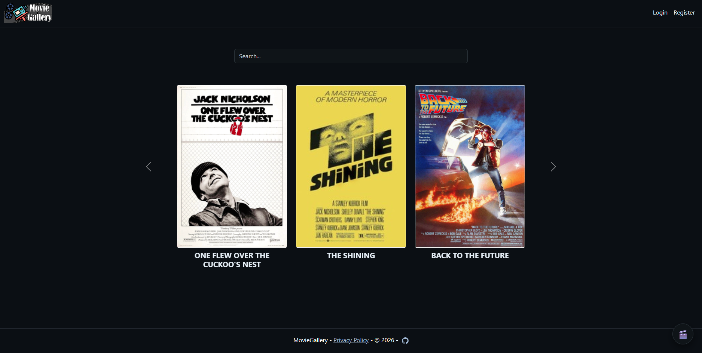
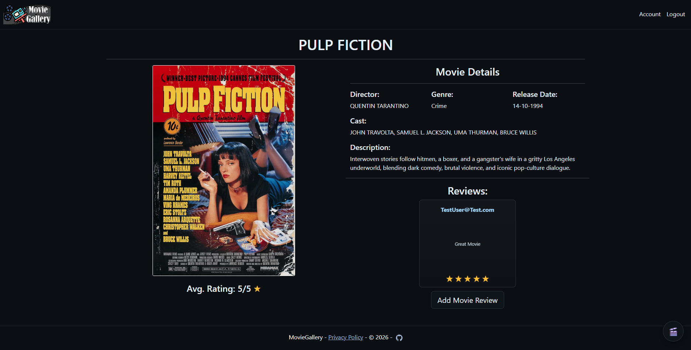
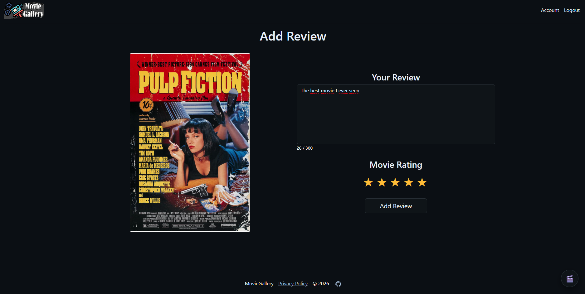
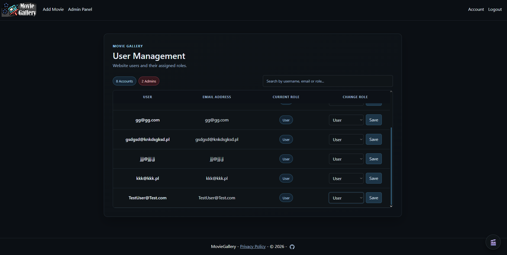
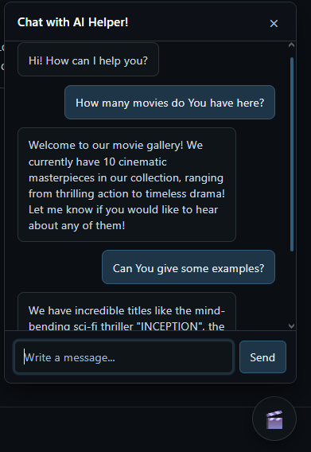

# MovieGallery

A web application for browsing a movie collection, rating films, and reading reviews. It also includes an AI assistant that answers questions using movie information available in the application.

## Features

- Browse the movie catalogue and search for titles.

- View movie details, including description, cast, director, release date, genres, and poster.

- Read and submit movie reviews and ratings.

- Register and sign in using ASP.NET Core Identity.

- Admin features for adding and editing movies and managing user roles. Admin operations require the `Admin` role.

- Ask the AI assistant questions about movies in the catalogue.

- Retrieve the catalogue through `GET /api/Movies`.

## Technology

- C# and ASP.NET Core on .NET 9.
- ASP.NET Core MVC with Razor views; Razor Pages are used for Identity account features.
- Entity Framework Core and Microsoft SQL Server.
- ASP.NET Core Identity.
- Google Generative AI integrated through `Microsoft.Extensions.AI`.

## Requirements

- .NET 9 SDK.
- Microsoft SQL Server, either locally or on a server accessible to the application.
- A Gemini API key to use the AI assistant.

## Run locally

1. Clone the repository and enter the project directory:

   git clone https://github.com/PrzegrywXDLOL/MovieGallery.git
   cd MovieGallery

2. Check the `DefaultConnection` connection string in `appsettings.json`. The default configuration uses a local SQL Server instance `(local)` and a database named `MovieGallery`. Update it to match your SQL Server setup if needed.

3. Apply the Entity Framework Core migrations:

   dotnet ef database update

If the `dotnet ef` command is unavailable, install the EF Core CLI tool:

   dotnet tool install --global dotnet-ef

4. (Optional) Set the Gemini API key as an environment variable. The application reads it from `GEMINI_API_KEY`:

   $env:GEMINI_API_KEY = "YOUR_API_KEY"

This setting applies to the current PowerShell session. Do not commit API keys to the repository.

5. Restore dependencies and run the application:

   dotnet restore
   dotnet run

Open the HTTP or HTTPS address printed in the console.

> Account confirmation is required before sign-in. Account registration and sign-in therefore also depend on the account-confirmation setup in the environment.

## API

`GET /api/Movies` returns the movie catalogue, including reviews. The local URL will look like this:

https://localhost:<port>/api/Movies

Find the port in the console output when the application starts.

## Project structure

- `Controllers/` — application and API controllers.
- `Views/` — Razor views for the MVC interface.
- `Models/` — domain models and view models.
- `Services/` — application and data-access services.
- `Data/` — Entity Framework Core context and migrations.
- `Agents/` — AI assistant integration.
- `Areas/Identity/` — Razor Pages for user account features.
- `wwwroot/` — static files, including CSS, JavaScript, and image assets.